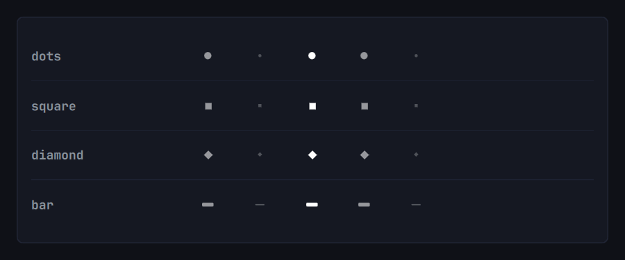

# Workspace Shape Indicator

A minimal workspace indicator for the Omarchy status bar, drawn as native vector shapes — no extra fonts or packages. Instead of numbers, each workspace is a clean shape:

- an empty workspace is a faint, smaller shape,
- a workspace with windows is a solid shape,
- the focused workspace is drawn at full brightness.



---

## Shapes

Choose from four core geometric shapes: `dots`, `square`, `diamond`, or `bar`.

---

## Install

Installs in place of the stock workspace widget:

```sh
omarchy plugin add https://github.com/1ternal/workspace-shape-indicator.git --enable
```

Remove it and the stock widget returns:

```sh
omarchy plugin remove io.github.1ternal.wsi
```

---

## Usage

- **Click** a shape to switch to that workspace.
- **Scroll** over the indicator to move between workspaces.
- **Keyboard**: the usual `SUPER + 1..9` works unchanged.

---

## Configure

Set any option with `omarchy bar set io.github.1ternal.wsi <key> <value>`:

```sh
omarchy bar set io.github.1ternal.wsi mode square          # dots | square | diamond | bar
omarchy bar set io.github.1ternal.wsi colorScheme monotone # theme | monotone
omarchy bar set io.github.1ternal.wsi density relaxed      # compact | normal | relaxed
omarchy bar set io.github.1ternal.wsi workspaces 8         # 1..10
omarchy bar set io.github.1ternal.wsi hideEmpty true       # true | false
omarchy bar set io.github.1ternal.wsi scroll false         # true | false
omarchy bar set io.github.1ternal.wsi dim 0.7 --json       # 0.2..0.9; pins the value
omarchy bar set io.github.1ternal.wsi dim null --json      # unset: follow the system again
```

| Setting | Values | Default | What it does |
| :--- | :--- | :--- | :--- |
| `mode` | `dots`, `square`, `diamond`, `bar` | `dots` | Shape drawn for each workspace. |
| `colorScheme` | `theme`, `monotone` | `theme` | `theme` follows the bar's text color; `monotone` draws pure black or white, picked from the theme background lightness. |
| `density` | `compact`, `normal`, `relaxed` | `normal` | Slot width and vertical padding. |
| `workspaces` | `1`–`10` | `5` | Minimum number of slots, always shown. Ignored when `hideEmpty` is `true`. |
| `hideEmpty` | `true`, `false` | `false` | `false`: keep slots `1..N` and grow only when a higher workspace is used. `true`: show only occupied workspaces plus the focused one. |
| `dim` | `0.2`–`0.9` | unset | Opacity of non-focused workspaces. Unset follows the system style token; any explicit value pins it, even one equal to a theme default. Reset with `dim null --json`. |
| `scroll` | `true`, `false` | `true` | Wheel over the widget switches workspaces. |

---

## Slot layout

Slots are contiguous: `1..max(workspaces, highest workspace in use)`. A slot's position therefore always equals its workspace number, so you can read the focused one by counting. Using a higher workspace widens the bar to include the empty slots in between; returning to the base range shrinks it. `hideEmpty: true` replaces this with occupied-only slots. Workspaces above 10 are not shown.

---

## License

MIT © [1ternal](https://github.com/1ternal). See [LICENSE](LICENSE).
